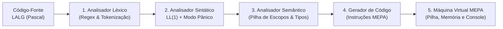

# Compilador LALG & IDE Web Interativa (Python + React 19) ⚙️💻

> **Compilador completo de 5 estágios para a linguagem LALG (subconjunto do Pascal) com geração e interpretação de código intermediário MEPA e ambiente visual de depuração.**

[](https://www.python.org/)
[](https://flask.palletsprojects.com/)
[](https://react.dev/)
[](https://zustand-demo.pmnd.rs/)
[](https://vitejs.dev/)

---

## 🎯 Visão Geral

Este projeto implementa um **compilador completo de ponta a ponta** para a linguagem acadêmica **LALG (baseada em Pascal)**, acompanhado de uma **IDE Web interativa**.

O motor do compilador (desenvolvido em **Python**) executa todas as fases clássicas de tradução — desde a varredura de caracteres até a geração de instruções para a máquina de pilha **MEPA (Máquina de Execução para Pascal)** e sua execução em uma máquina virtual própria com inspeção de registradores e memória.

---

## 🔄 Pipeline de Compilação (5 Estágios)



### Detalhamento Técnico das Fases (`Backend/`)

1. **Análise Léxica (`Backend/lexico/`):**
   * Varredura do código-fonte com remoção automática de comentários de linha (`//`) e bloco (`{ ... }`).
   * Identificação de palavras reservadas (`program`, `procedure`, `var`, `begin`, `end`, `if`, `then`, `else`, `while`, `do`, `int`, `boolean`, `real`), operadores relacionais/aritméticos e identificadores, mantendo o rastreamento exato de linha e coluna.
2. **Análise Sintática Preditiva LL(1) (`Backend/sintatico/sintatico.py`):**
   * Parser preditivo não-recursivo dirigido por tabela (`Backend/tabelas/Completa.csv`).
   * **Recuperação de Erros em Modo Pânico:** Utiliza conjuntos de sincronização **`FOLLOW`** (`follow_sets.py`) para descartar tokens inválidos de forma segura e continuar a análise sintática, reportando múltiplos erros amigáveis em uma única compilação.
3. **Análise Semântica (`Backend/semantico/semantico.py`):**
   * **Tabela de Símbolos com Pilha de Escopos:** Gerencia o escopo `global` e escopos locais aninhados de `procedure`, preservando o histórico completo para inspeção no frontend.
   * Validação de declarações duplicadas, variáveis não declaradas, aridade/tipos de parâmetros em chamadas de procedimentos e compatibilidade de tipos em atribuições (`:=`) e expressões lógicas/aritméticas.
4. **Geração de Código Intermediário (`Backend/sintatico/gerador.py`):**
   * Tradução direta das construções sintáticas para instruções assembly da máquina de pilha **MEPA** (`INPP`, `AMEM`, `DMEM`, `CRCT`, `CRVL`, `ARMZ`, `SOMA`, `SUBT`, `MULT`, `DIVI`, `CMMA`, `CMME`, `CMIG`, `DSVF`, `DSVS`, `ENPR`, `CHPR`, `RTPR`, `LEIT`, `IMPR`, `PARA`) com resolução automática de rótulos de desvio (`R00`, `R01`, ...).
5. **Interpretador / Máquina Virtual MEPA (`Backend/mepa/MepaInterpreter.py`):**
   * Simulador de execução que interpreta o código MEPA gerado, controlando o contador de programa (`PC`), o topo da pilha (`S`), o vetor de memória de dados (`D[0..100]`) e o buffer de entrada/saída (`LEIT` / `IMPR`).

---

## 🖥️ Funcionalidades da IDE Web (`Frontend/`)

Construída com **React 19**, **Zustand**, **Framer Motion** e **React Ace Editor**:

* **🎨 Syntax Highlighting Customizado (`Lalg.mode.jsx`):** Modo de destaque léxico exclusivo para a gramática LALG no editor Ace, com marcação visual de linhas com erro.
* **📊 Inspeção de Tabelas em Abas:**
  * **Tabela Léxica (`Table.jsx`):** Lista de lexemas, tokens reconhecidos, linhas e colunas.
  * **Tabela de Símbolos (`SymbolTable.jsx`):** Visualização das variáveis, procedimentos e parâmetros agrupados por escopo (`global`, `proc_1`, etc.).
  * **Tabelas LL(1) (`CsvTable.jsx`):** Consulta interativa às tabelas de parsing (`Programa`, `Comandos`, `Expressoes` e `Completa`).
* **⚡ Console de Erros & Máquina MEPA (`Mepa.jsx` e `Panel.jsx`):** Exibição lado a lado das instruções MEPA geradas, diagnósticos léxicos/sintáticos/semânticos e saída da execução do programa.

---

## 📂 Estrutura do Repositório

```text
compiladores/
├── Backend/
│   ├── lexico/            # Definição do alfabeto (alfabeto.py) e tokenizador (lexico.py)
│   ├── sintatico/         # Parser LL(1) (sintatico.py), conjuntos FOLLOW e gerador MEPA (gerador.py)
│   ├── semantico/         # Tabela de Símbolos em pilha e verificador de tipos (semantico.py)
│   ├── mepa/              # Especificação de instruções e Máquina Virtual (MepaInterpreter.py)
│   ├── tabelas/           # Tabelas de parsing LL(1) em formato CSV
│   └── main.py            # Servidor Flask REST (/enviar_conteudo)
└── Frontend/
    └── src/
        ├── components/    # Editor Ace (modo LALG), SymbolTable, CsvTable, Mepa, Panel, Tabs
        └── store/         # Estado global reativo da IDE com Zustand (useStore.js)
```

---

## 🧪 Exemplo de Código LALG Suportado

```pascal
program exemplo;
var a, b, soma : int;
begin
    a := 10;
    b := 20;
    if (a < b) then
    begin
        soma := a + b;
        write(soma)
    end
end.
```

---

## 🚀 Como Executar Localmente

### 1. Iniciando o Backend (Python + Flask)

```bash
cd Backend

# Crie e ative o ambiente virtual
python -m venv venv
source venv/bin/activate  # No Windows: .\venv\Scripts\activate

# Instale as dependências e inicie o servidor (porta 5000)
pip install flask flask-cors
python main.py
```

### 2. Iniciando o Frontend (React + Vite)

Em outro terminal:

```bash
cd Frontend

# Instale as dependências e inicie o servidor de desenvolvimento
npm install
npm run dev
```

Acesse a aplicação no navegador através do endereço exibido pelo Vite (por padrão `http://localhost:5173`).
